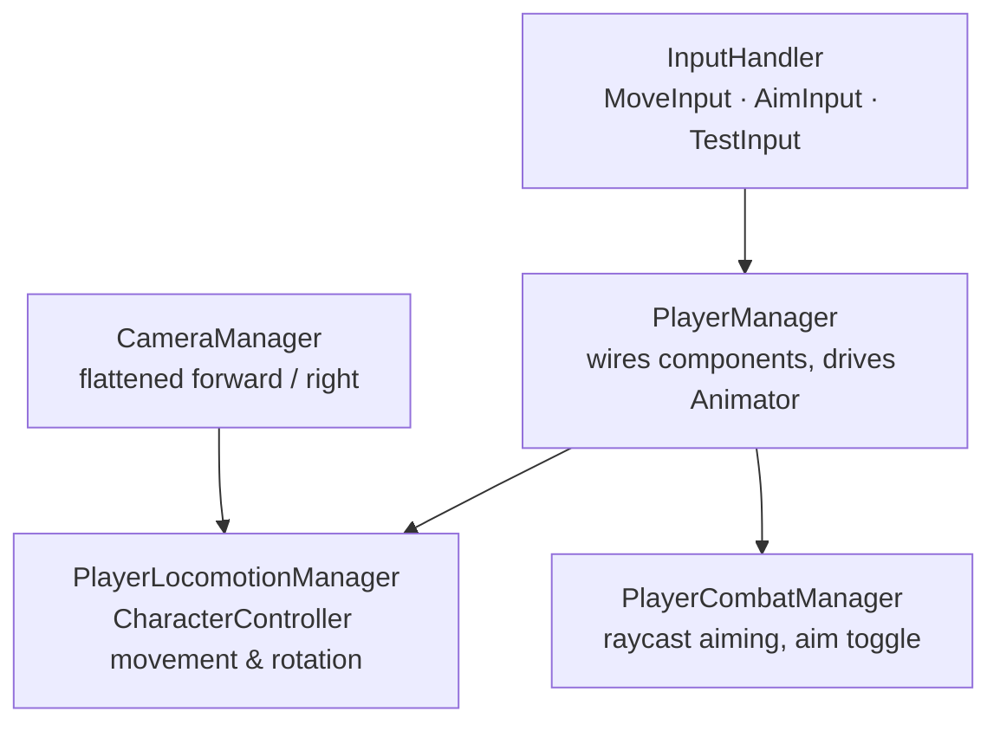

<div align="center">

# Project TDS

**A 3D top-down shooter in Unity 6 — currently in early development.**

[](https://unity.com/)
[](https://learn.microsoft.com/dotnet/csharp/)
[](https://docs.unity3d.com/Packages/com.unity.render-pipelines.universal@17.1/manual/index.html)
[](https://docs.unity3d.com/Packages/com.unity.inputsystem@1.14/manual/index.html)
[](#roadmap)

</div>

---

> [!NOTE]
> **Work in progress.** The project is at the prototype stage: player movement, mouse aiming and the animation setup are in place; combat, enemies and levels are still to come.

## What's implemented

| Feature | How it works |
| --- | --- |
| **Camera-relative movement** | WASD input is projected onto the camera's flattened forward/right vectors and applied through a `CharacterController` |
| **Mouse aiming** | A ray from the cursor hits the aimable layers; the player turns to face the hit point and an aim target follows it |
| **Aim / free-move toggle** | While aiming the character keeps facing the cursor (strafing); otherwise it smoothly rotates toward the move direction |
| **Blend-tree ready animation** | Speed, local X/Y velocity and an `isArmed` flag are fed to the Animator every frame |
| **New Input System** | Actions are defined in `PlayerControls.inputactions` and wrapped by an `InputHandler` component |

## Controls

| Action | Input |
| --- | --- |
| Move | <kbd>W</kbd> <kbd>A</kbd> <kbd>S</kbd> <kbd>D</kbd> |
| Aim | Mouse |
| Toggle aim mode *(debug)* | <kbd>T</kbd> |

A **Jump** action (<kbd>Space</kbd>) is already defined in the input actions but not hooked up yet.

## Architecture

The player is split into small components coordinated by a central `PlayerManager`:



```text
Assets/
├── Scripts/
│   └── Player/
│       ├── PlayerManager.cs            # Component hub + animator parameters
│       ├── PlayerLocomotionManager.cs  # Movement and rotation
│       ├── PlayerCombatManager.cs      # Mouse aiming
│       ├── CameraManager.cs            # Camera-relative directions
│       └── Controls/
│           ├── InputHandler.cs
│           ├── PlayerControls.cs
│           └── PlayerControls.inputactions
├── Animations/Player/
├── Scenes/SampleScene.unity
├── Settings/      # URP assets (PC & Mobile renderers)
└── Thirdparty/    # Art and animation packs
```

## Getting started

**Requirements:** [Unity **6000.1.6f1**](https://unity.com/releases/editor/archive) (Unity 6)

```bash
git clone https://github.com/ygokdogan/ProjectTDS.git
```

1. Open the folder in **Unity Hub** → *Add project from disk*.
2. Open `Assets/Scenes/SampleScene.unity`.
3. Press **Play**.

## Roadmap

- [x] Camera-relative movement
- [x] Mouse aiming and strafing
- [x] Locomotion animation parameters
- [ ] Shooting and weapons
- [ ] Enemies and AI
- [ ] Health, damage and UI
- [ ] Levels

## Credits

Third-party art and animation packs in `Assets/Thirdparty/` (Synty Studios, Kevin Iglesias, Ciathyza) belong to their respective authors and are used under their own licenses.

---

<div align="center">

Made by [**Yusuf Emir Gökdoğan**](https://github.com/ygokdogan)

</div>
